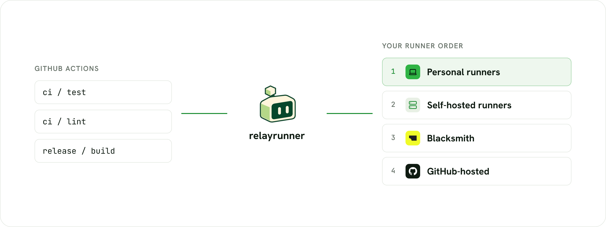
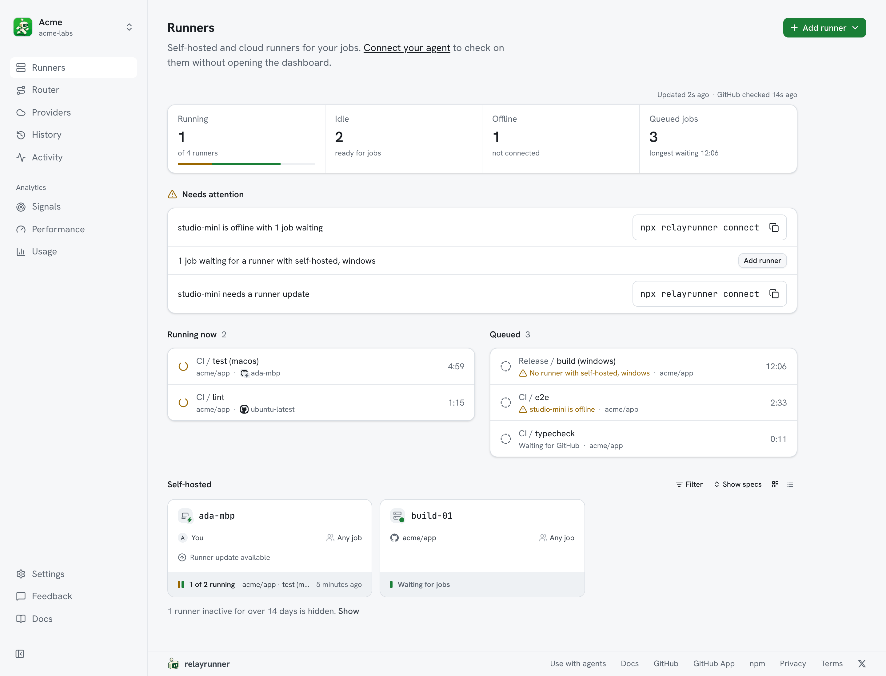
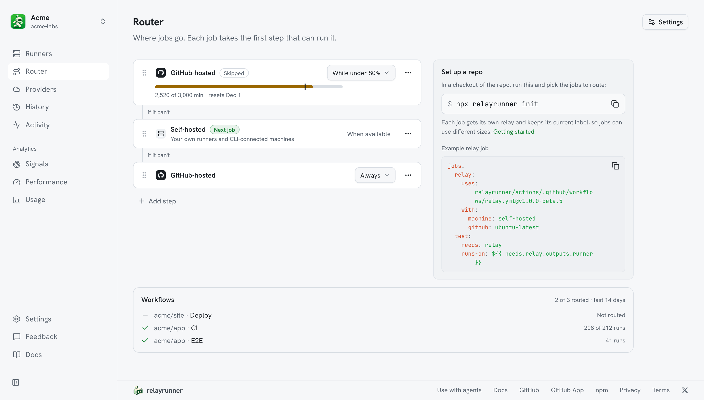
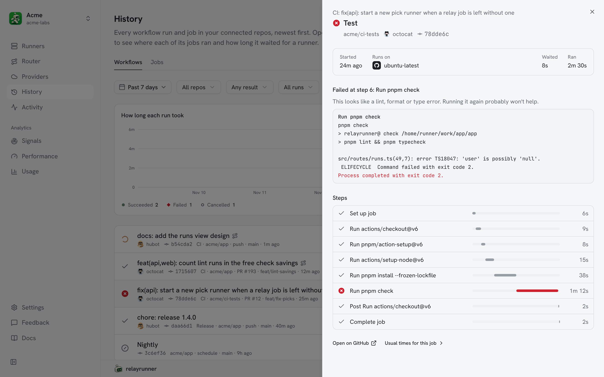
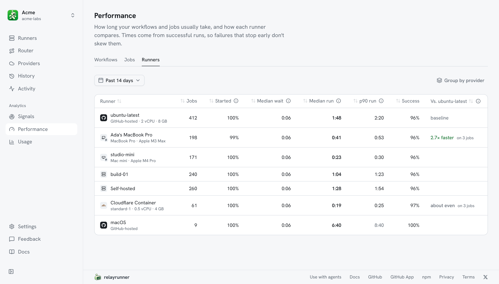
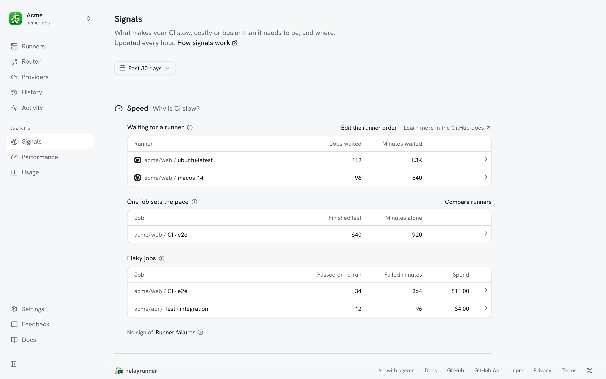

<div align="center">

<picture>
  <source media="(prefers-color-scheme: dark)" srcset=".github/readme/hero-dark.png">
  
</picture>

<h1>RelayRunner</h1>

**Route GitHub Actions jobs to the runners you already have.**

<p>
  <a href="https://github.com/apps/relayrunner"><b>Install the GitHub App</b></a> &nbsp;·&nbsp;
  <a href="https://app.relayrunner.app"><b>Dashboard</b></a> &nbsp;·&nbsp;
  <a href="https://relayrunner.app">Website</a> &nbsp;·&nbsp;
  <a href="https://relayrunner.app/docs/get-started/quickstart">Quickstart</a> &nbsp;·&nbsp;
  <a href="https://relayrunner.app/docs">Docs</a>
</p>

<p>
  <a href="https://github.com/apps/relayrunner"></a>
  <a href="https://github.com/relayrunner/relayrunner/actions/workflows/ci.yml"></a>
  <a href="https://www.npmjs.com/package/relayrunner"></a>
  <a href="https://skills.sh/relayrunner/relayrunner"></a>
  <a href="https://relayrunner.app/docs/reference/mcp"></a>
  <a href="LICENSE"></a>
</p>

</div>

Each job goes to the first runner in your order that can take it right now: one of your own machines when it's online and free, an existing self-hosted runner, a hosted provider such as Blacksmith or Depot, or GitHub's hosted runners. You keep your usual push workflow and see the same checks and logs in GitHub.

It's built for small teams and individuals who don't want to pay for every push, and for any team whose CI usage spikes. Your laptops and other machines take jobs while they're online, and hosted runners take the rest.

[PRODUCT.md](PRODUCT.md) describes the product in full: how routing works, the runner providers, and the principles behind them.

## Get started

1. **[Install the GitHub App](https://github.com/apps/relayrunner)** on an organization or personal account. Each install is its own workspace, and everyone who can see the install on GitHub is a member.
2. **Connect a machine** with `npx relayrunner connect`. While it runs, the machine takes jobs; Ctrl-C takes it offline.
3. **Opt a job in** by adding a relay job in front of it and pointing its `runs-on` at the relay's answer:

   ```yaml
   jobs:
     relay-test:
       uses: relayrunner/actions/.github/workflows/relay.yml@v1
       with:
         machine: self-hosted # any connected machine
         github: ubuntu-latest # used when no machine is free

     test:
       needs: relay-test
       runs-on: ${{ needs.relay-test.outputs.runner }}
       steps:
         - uses: actions/checkout@v4
         - run: npm test
   ```

   The relay job gets its answer in about a second and bills no minutes. If nothing fits, it fails with the reason instead of leaving the job queued.

Public repositories never run on connected machines, since anyone could run code there through a pull request. The relay workflow and the optimized checks live in [relayrunner/actions](https://github.com/relayrunner/actions).

## The dashboard

**Runners.** See what's running and queued right now, which runners are busy, and anything that needs you, like an offline machine with a job waiting.

<picture>
  <source media="(prefers-color-scheme: dark)" srcset=".github/readme/runners-dark.png">
  
</picture>

**Router.** Put your runners in order. Each job takes the first one that can run it.

<picture>
  <source media="(prefers-color-scheme: dark)" srcset=".github/readme/router-dark.png">
  
</picture>

**History.** See every run and job, where it ran and how long it waited. A failed job shows the failing step, its log and whether a re-run will likely help.

<picture>
  <source media="(prefers-color-scheme: dark)" srcset=".github/readme/history-dark.png">
  
</picture>

**Performance.** Compare how long jobs take on each runner.

<picture>
  <source media="(prefers-color-scheme: dark)" srcset=".github/readme/performance-dark.png">
  
</picture>

**Signals.** Find what makes your CI slow or costly, such as long runner waits and flaky jobs.

<picture>
  <source media="(prefers-color-scheme: dark)" srcset=".github/readme/signals-dark.png">
  
</picture>

## Use with agents

Give your coding agent the RelayRunner skills, so it can set up machines, route your jobs and read your CI for you:

```sh
npx skills add relayrunner/relayrunner
```

They work with Claude Code, Codex, Cursor and most other agents. See [`skills/`](skills) for what each one does. Without them, [docs/agent-install.md](docs/agent-install.md) walks an agent through the whole setup in one prompt.

Agents can also read your workspace through the [MCP server](https://relayrunner.app/docs/reference/mcp) at `https://agents.relayrunner.app/mcp`.

## Repository layout

This is a pnpm workspace. The apps are deployed as Cloudflare Workers, except the CLI, which is published to npm.

| App                              | What it is                                                                                  |
| -------------------------------- | ------------------------------------------------------------------------------------------- |
| [`apps/api`](apps/api)           | The gateway: auth, workspaces, routing, the webhook queue consumer and the Durable Objects. |
| [`apps/web`](apps/web)           | The dashboard, a React SPA that reaches the API over a service binding.                     |
| [`apps/webhooks`](apps/webhooks) | Verifies GitHub webhook deliveries and queues them for the API.                             |
| [`apps/agents`](apps/agents)     | The MCP server agents connect to, read-only, at agents.relayrunner.app/mcp.                 |
| [`apps/cli`](apps/cli)           | The `relayrunner` CLI that connects a machine to a workspace.                               |
| [`apps/site`](apps/site)         | The public site at [relayrunner.app](https://relayrunner.app): landing page and docs.       |

| Package                                                  | What it is                                                             |
| -------------------------------------------------------- | ---------------------------------------------------------------------- |
| [`packages/access`](packages/access)                     | Cloudflare Access JWT checks and the gate for operator `/admin` views. |
| [`packages/activity`](packages/activity)                 | Activity log event schemas and feed types shared by the API and web.   |
| [`packages/email`](packages/email)                       | Transactional email templates.                                         |
| [`packages/github-webhooks`](packages/github-webhooks)   | Webhook signature checks and the compact queue message format.         |
| [`packages/lint-runner`](packages/lint-runner)           | The lint container image and its protocol with the API.                |
| [`packages/machine-protocol`](packages/machine-protocol) | Messages between a connected machine and the gateway.                  |
| [`packages/runner-order`](packages/runner-order)         | The runner order schema, defaults and labels.                          |

Each app and package has its own README. Longer write-ups live in [`docs/`](docs): [Cloudflare Access](docs/cloudflare-access.md), the [GitHub App](docs/github-app.md) and the [pick runner](docs/architecture/pick-runner.md).

## Development

Use the Node.js version in `.nvmrc` (24.x) and pnpm 11 (pinned by `packageManager`, so Corepack picks it up). Then, from the repository root:

```sh
pnpm install
pnpm check
```

`pnpm check` runs everything CI runs:

- `pnpm lint` runs Oxlint.
- `pnpm format` formats with oxfmt; `pnpm format:check` verifies it.
- `pnpm typecheck` checks types without emitting JavaScript.
- `pnpm test` runs the Vitest suite once; `pnpm test:watch` reruns affected tests as files change.

Write code in TypeScript and put tests next to the code they cover, as `*.test.ts` or `*.test.mts`. `pnpm install` sets up a Husky pre-commit hook that runs Oxlint and oxfmt on staged files and then type checks. In VS Code or Cursor, install the recommended Oxc extension to format on save.

To run the stack locally, start the API and the dashboard (see [`apps/api`](apps/api#run-it-locally) and [`apps/web`](apps/web#develop)).

### Environment files

Each place that reads local settings has an example to copy. The copies are gitignored.

| Example                                                    | Copy to     | For                                                                         |
| ---------------------------------------------------------- | ----------- | --------------------------------------------------------------------------- |
| [`.env.example`](.env.example)                             | `.env`      | Cloudflare API credentials and the Access service token for admin commands. |
| [`apps/api/.dev.vars.example`](apps/api/.dev.vars.example) | `.dev.vars` | The API's local secrets: Better Auth and the GitHub App's OAuth client.     |
| [`apps/web/.env.example`](apps/web/.env.example)           | `.env`      | Where the dashboard's dev server proxies `/api`.                            |

The webhooks Worker has none: its secrets live in the Secrets Store (see [`apps/webhooks`](apps/webhooks#run-it-locally)). The CLI reads `RELAYRUNNER_URL` and `RELAYRUNNER_HOME` from the shell (see [`apps/cli`](apps/cli)).

## Contributing

Commit messages and pull request titles use [Conventional Commits](https://www.conventionalcommits.org/), such as `feat(api): add runner order rules`. [AGENTS.md](AGENTS.md) has the full conventions, which apply to people and coding agents alike.

## License

RelayRunner is licensed under the [Apache License 2.0](LICENSE).
