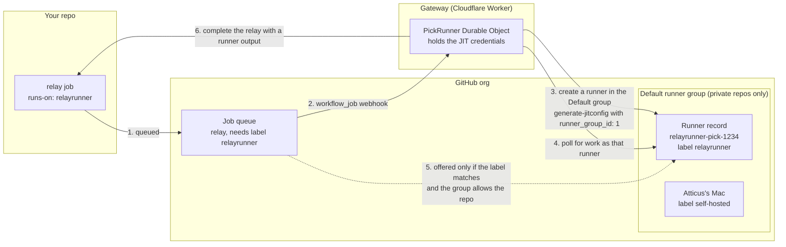
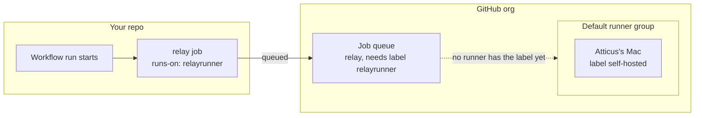
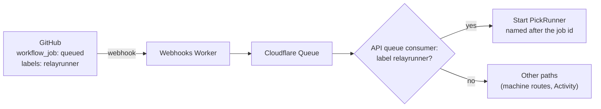
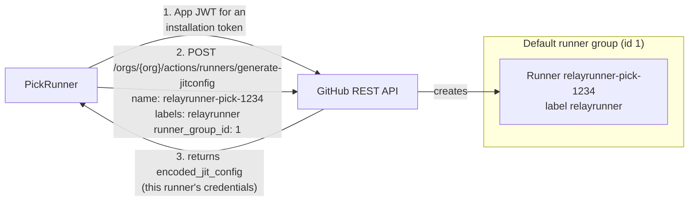
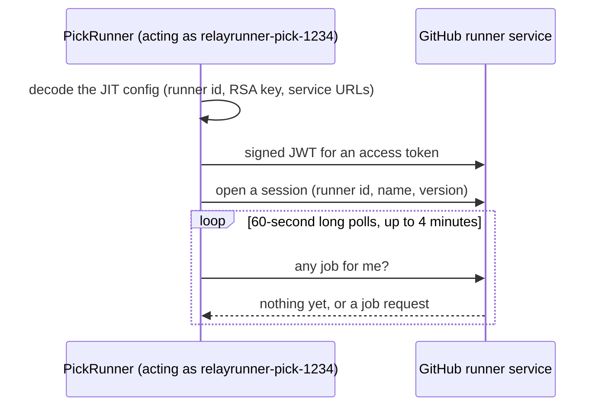
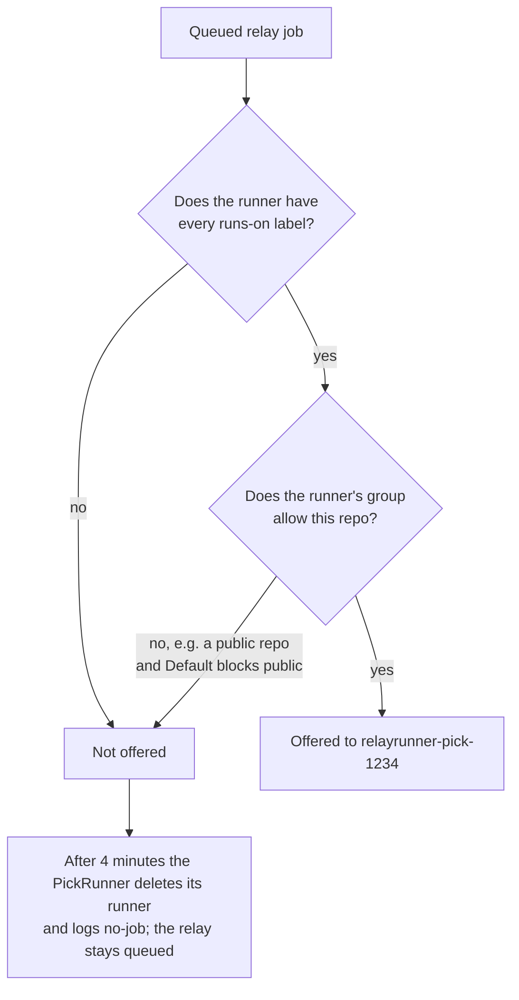
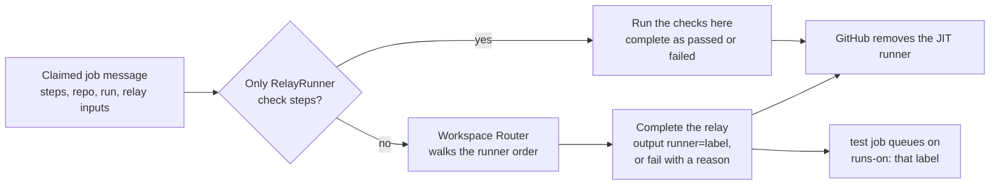

# Pick runner

**Covers:** `apps/api/src/durable-objects/pick-runner.ts`, `apps/api/src/github-app.ts` (`generateOrgJitConfig`, `deleteOrgRunner`, `DEFAULT_RUNNER_GROUP_ID`, runner groups), `apps/api/src/runner-protocol.ts`, and the `queued` path in `apps/api/src/webhook-queue.ts`.

## What it does

The pick runner is how RelayRunner gets hold of a `relay` job. Every relay job asks for `runs-on: relayrunner`, and GitHub only hands a job to a runner registered with a matching label. So for each queued relay job, the gateway registers its own one-job runner with the `relayrunner` label, claims the job, and completes it with a `runner` output. It never runs a step.

The pick runner is the piece that decides, so it has to get the job before anything can be chosen. If GitHub never offers the relay job to the pick runner, nothing is routed: no machine, no GitHub-hosted runner, no Blacksmith. The relay job just stays queued.

## What a runner is to GitHub

To GitHub, a self-hosted runner is two things:

1. **A registration record** in the org: a name, labels, and the one runner group it belongs to.
2. **Whoever holds that record's credentials and asks GitHub for work.** Normally that's GitHub's runner program on a machine. GitHub doesn't check what's on the other end, only that it speaks the runner protocol.

The pick runner uses exactly that. Nothing is provisioned and no VM starts. The gateway makes one API call that creates the record and returns its credentials. The group is a field of that call (`runner_group_id`), so the runner is born in the group and is never added to it later. A Durable Object then holds the credentials and polls GitHub the way the runner program would.

Compared with a vanilla self-hosted runner:

|                      | Vanilla runner (e.g. a Mac)                       | Pick runner                                    |
| -------------------- | ------------------------------------------------- | ---------------------------------------------- |
| Registered by        | `./config.sh` with a registration token           | `generate-jitconfig` API call from the gateway |
| Group chosen         | At config time (Default unless another is picked) | In the API call: `runner_group_id: 1`          |
| Asks GitHub for jobs | The runner program on the machine                 | A Durable Object in the Worker                 |
| Lives                | Until removed                                     | One job, or 4 minutes                          |
| Runs job steps       | Yes                                               | No, it only sets the `runner` output           |

## Step by step

Each step below zooms into one numbered arrow of the map above.

### 1. The relay job is queued

The `relay` job comes from `relay.yml` in [relayrunner/actions](https://github.com/relayrunner/actions) and asks for `runs-on: relayrunner`. GitHub looks for a runner that has every label the job asks for. No runner has `relayrunner` yet, so the job waits in the queue. GitHub keeps a self-hosted job queued for up to 24 hours.

### 2. GitHub tells the gateway

The App gets a `workflow_job` webhook with `action: queued` and the job's labels. The Webhooks Worker puts it on a Cloudflare Queue. The consumer in `apps/api/src/webhook-queue.ts` starts a `PickRunner` Durable Object named after the job id. `start()` is idempotent, so a redelivered webhook does nothing.

### 3. The gateway creates a runner in the Default runner group

This is where the runner comes into existence, and it is created **inside** a runner group. The `runner_group_id` in the request decides which group. The gateway always sends `1`, which is Default (`DEFAULT_RUNNER_GROUP_ID` in `apps/api/src/github-app.ts`). Nothing adds the runner to a group afterwards. The response's `encoded_jit_config` holds the runner's identity and an RSA key. Whoever holds it can act as that runner, for one job.

### 4. The PickRunner connects as that runner

No VM or runner binary is involved. The Durable Object does what GitHub's runner program does on a machine (`RunnerClient` in `apps/api/src/runner-protocol.ts`). It signs a JWT with the RSA key to get an access token, opens a session, and long-polls for work. It reports a recent official runner version, because GitHub won't send jobs to an old one.

### 5. GitHub decides whether to offer the job

Both checks must pass. The group check is explained in [Who gets the job](#who-gets-the-job-labels-and-runner-groups). GitHub may offer **any** queued job in the org that passes them, including another repo's relay. So the PickRunner always takes the repo and run from the job it claimed, not from the webhook that woke it.

### 6. The PickRunner answers the job

The PickRunner claims the job and completes it without running any steps. A job made only of `relayrunner/actions/checks/*` steps is answered as a check (`apps/api/src/native-checks.ts`). Otherwise the workspace's Router picks a runner (see routing), and the relay completes with a `runner` output or fails with a reason. The decision is recorded for the Activity page. A JIT runner gets one job, so GitHub removes it afterwards. The PickRunner logs `relayrunner pick finished` with a `result`: `routed`, `no_runner`, `check_passed`, `check_failed`, `no-job` or `error`.

## Who gets the job: labels and runner groups

GitHub offers a queued job to a self-hosted runner only when **both** of these hold:

1. **The labels match.** The job's `runs-on` labels are all on the runner. The pick runner has exactly one label, `relayrunner`. GitHub adds no `self-hosted`, OS or arch defaults to a JIT runner, so ordinary `runs-on: self-hosted` jobs can't land on it.
2. **The runner's group allows the repo.** Every org runner lives in exactly one runner group, and the group says which repos may use its runners:
   - **Repository access:** all repos, or selected repos only.
   - **Allow public repositories:** off by default. While it's off, no public repo's job reaches any runner in the group.
   - **Workflow access:** optionally, only selected workflows.

The pick runner always registers in the org's **Default** group (`runner_group_id: 1`). Default allows private repos only until an org admin turns on "Allow public repositories" (Organization settings → Actions → Runner groups → Default). Machine runners (`apps/api/src/durable-objects/machine-link.ts`) register in Default too.

| Repo                           | Label matches | Default allows the repo | Result                                     |
| ------------------------------ | ------------- | ----------------------- | ------------------------------------------ |
| relayrunner-ci-tests (private) | yes           | yes                     | Pick runner claims the relay and routes it |
| relayrunner, actions (public)  | yes           | no                      | Never offered; `no-job` after 4 minutes    |

Orgs on GitHub Free can't create extra runner groups. Default is the only one they have, and its settings apply to every self-hosted runner in the org. Personal accounts have no runner groups. Their runners are registered per repo, which this code doesn't do yet (#68).

## Decisions and why

- **One JIT runner per job, not a long-lived runner.** A JIT config works for a single job, so there is no runner credential to store or rotate. Nothing polls GitHub while CI is idle. Parallel relays get parallel runners, because a runner session takes one job at a time anyway. Runners that crash don't linger as offline entries. The cost is a few seconds and a couple of API calls per job, and a dependence on the `queued` webhook (see failure modes).
- **A Durable Object instead of a real runner.** Picking needs no machine, only the runner protocol, so a Worker can answer a relay in seconds without paying for a VM.
- **The pick never runs code from the job.** It only reads the job message and completes it. That is what would make it safe to expose to public repos and fork PRs, which is not true of machine runners or vanilla self-hosted runners.
- **Default group.** Every org has it, including Free orgs, and the App can register in it with only the "Self-hosted runners" org permission. The cost is that the group's repo access settings decide which repos the pick can serve, and today that excludes public repos.

## Failure modes

- **Default leaves the repo out (public repos not allowed, private only, or a selected list without it).** GitHub never offers the relay. Before registering, the PickRunner reads the Default group (`src/pick-access.ts`) and, when it leaves the repo out, registers no runner: it logs `relayrunner pick blocked`, adds a `job.unroutable` entry to Activity with the reason and the fix, posts a failed `RelayRunner` check run on the commit, and doesn't retry (the sweep skips it too). The relay job itself still stays queued on GitHub until someone cancels it or GitHub's 24-hour queue limit ends it, because only a runner GitHub hands the job to can fail it. Before this check the PickRunner logged `no-job` after 4 minutes with no explanation anywhere (relayrunner/relayrunner and relayrunner/actions on 2026-11-06, relayrunner-ci-tests on 2026-11-08). If the group can't be read, the pick goes ahead as before.
- **Default limited to selected workflows.** This isn't checked yet, so a workflow outside the list still fails silently with `no-job`.
- **A pick runner takes a different relay job.** GitHub matches on the label, not the job, so a runner made for one relay can be handed another one that's waiting (often an older one). That job is answered correctly, but the runner's own job is left with nobody. When a runner finishes, it asks GitHub whether its own job is still queued and, if so, starts a replacement, up to 4 runners per job (`src/pick-attempts.ts`). Before this, one lost job stole the next job's runner, and so on, until the queue emptied (2026-11-06 to 2026-11-09).
- **A pick runner is left registered.** If closing its session or deleting it fails, GitHub keeps showing it idle and can hand it a job nobody will ever take. Failures are logged (`relayrunner pick cleanup failed`), the delete is tried twice, and the 15-minute sweep removes `relayrunner-pick-*` runners whose run has ended (`src/pick-sweep.ts`).
- **The `queued` webhook is lost, or a deploy cuts a runner off mid-wait.** The 15-minute sweep starts another runner for any relay recorded as queued for more than 5 minutes, within the same 4-runner limit. A relay whose `queued` webhook never arrived has no row, so the sweep can't see it.
- **Another runner in the org has the `relayrunner` label.** It could take relay jobs instead of the gateway. GitHub picks among matching runners, and RelayRunner doesn't prevent it.
- **GitHub sends a message the client doesn't handle.** The poll ignores anything but a job request and logs its type (`runner poll message dropped`).
- **The installation lacks "Self-hosted runners: write" on the org.** `generate-jitconfig` fails, and the pick logs `result: error`.

## Code

- `apps/api/src/webhook-queue.ts`: `queued` webhooks with the `relayrunner` label start a PickRunner.
- `apps/api/src/durable-objects/pick-runner.ts`: registration, waiting, claiming, answering, cleanup, the `relayrunner pick finished` log.
- `apps/api/src/github-app.ts`: `generateOrgJitConfig`, `deleteOrgRunner`, `DEFAULT_RUNNER_GROUP_ID`, `listOrgRunnerGroups`, `getOrgRunnerGroup`.
- `apps/api/src/github-runners.ts`: `groupBlocksRepo`, the one rule for whether a runner group takes a repo's jobs, shared by the pick runner and routing to added runners.
- `apps/api/src/pick-access.ts`: the blocked reason and the check run that explains it.
- `apps/api/src/pick-attempts.ts`: when a runner is replaced and how pick runners are named.
- `apps/api/src/pick-sweep.ts`: the 15-minute rescue for stuck relays and removal of leftover pick runners.
- `apps/api/src/runner-protocol.ts`: `RunnerClient` (session, poll, claim, complete) and `decodeJitConfig`.
- `apps/api/src/native-checks.ts`: jobs answered as checks instead of routed.
